<div align="center">

# LogSentinel

**Cloud-native log monitoring with machine-learning anomaly detection.**
Ship logs over HTTP, stream them through Kafka, score every record with an Isolation Forest, and turn bursts of anomalies into incidents that page Slack and email — all running on Kubernetes.


-231F20?logo=apachekafka)


**[Live demo → logsentinel-log.vercel.app](https://logsentinel-log.vercel.app)**

</div>

## Live demo

<p align="center">
  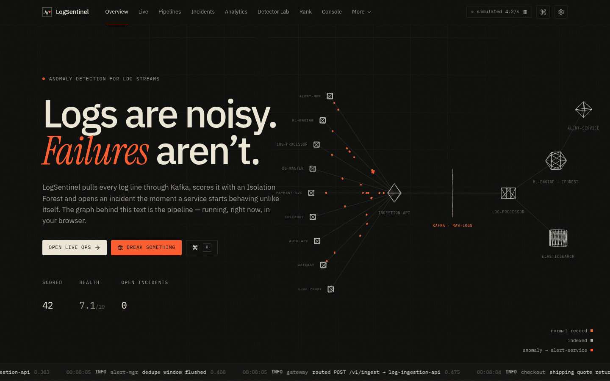
</p>

The graph on the landing page is the real service topology, rendered in three.js. Every amber packet is a log record travelling producer → ingestion API → Kafka → processor → Elasticsearch / ML engine; records the model scores as anomalous turn red and peel off to the alert service. The counters and the ticker at the bottom are live.

The hosted demo runs entirely in the browser: a built-in generator produces realistic traffic for nine services and a **JavaScript port of Isolation Forest** scores it, so every page works with no backend. Point it at a running `dashboard-backend` in **Settings → Data source** to read real logs instead.

| Live operations | Incidents |
| --- | --- |
| 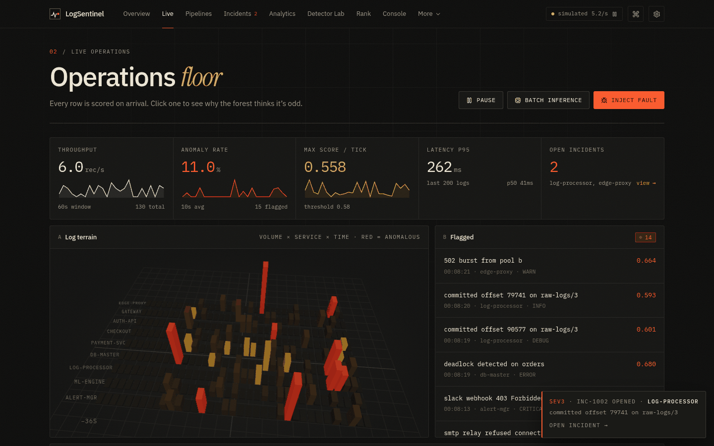 | 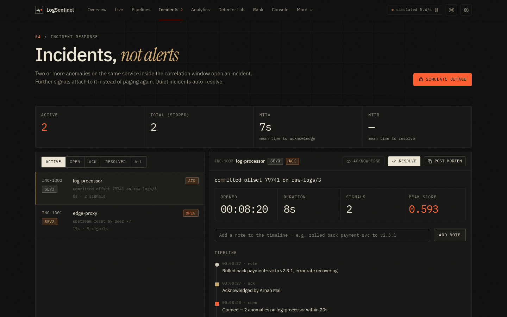 |
| **Detector Lab** | **Analytics** |
| 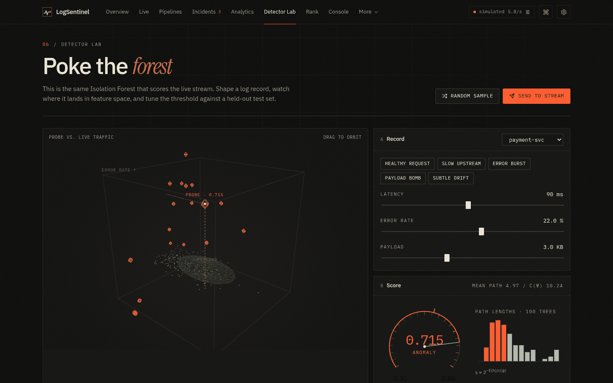 | 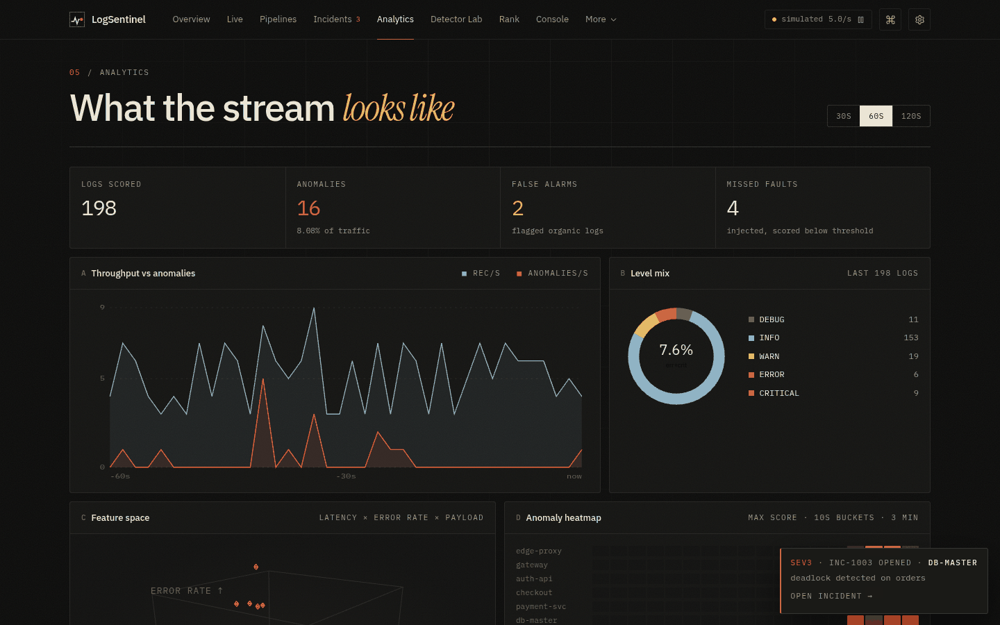 |
| **Pipelines & Kafka** | **Service ranking** |
| 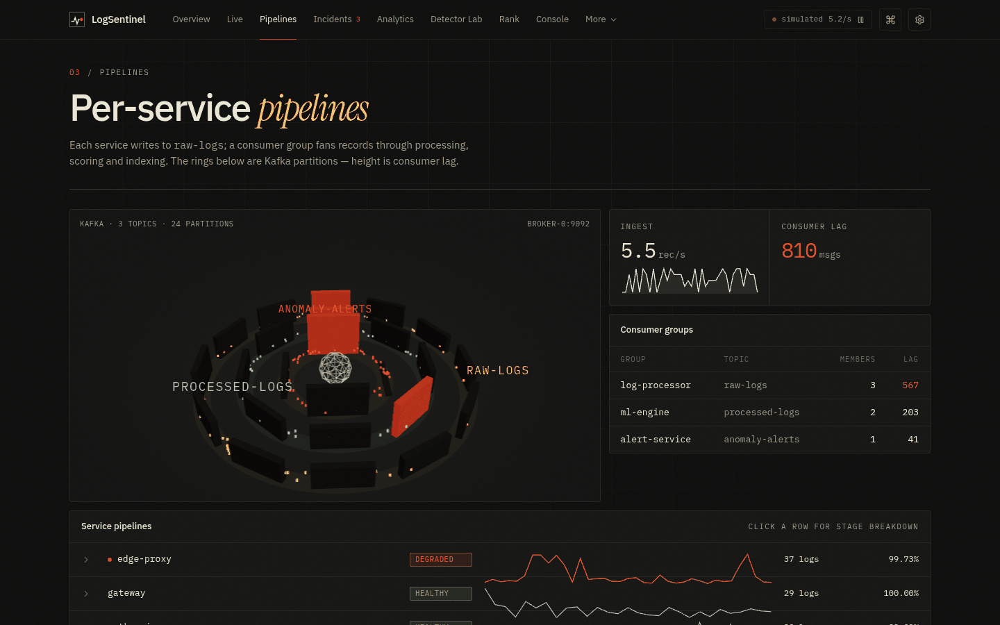 | 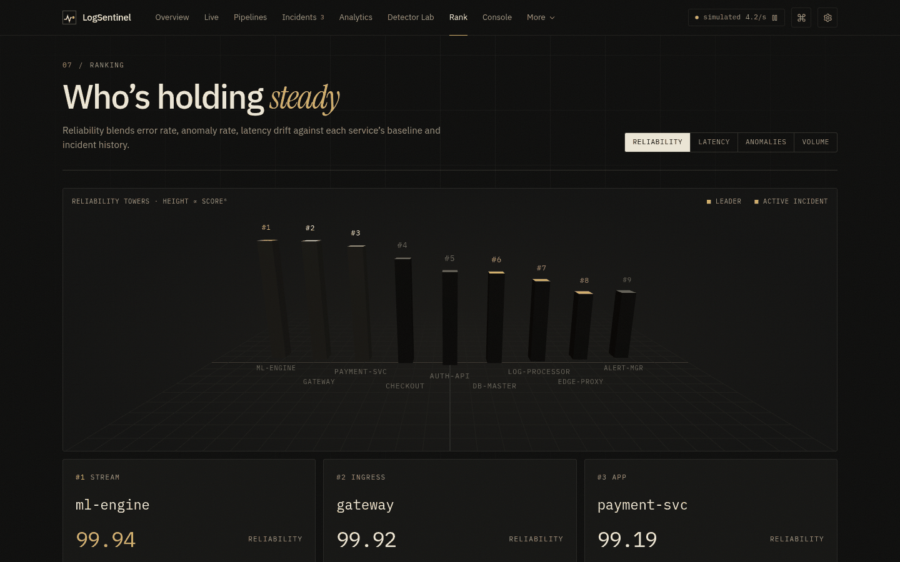 |
| **Operator console** | **Command palette (Ctrl + K)** |
| 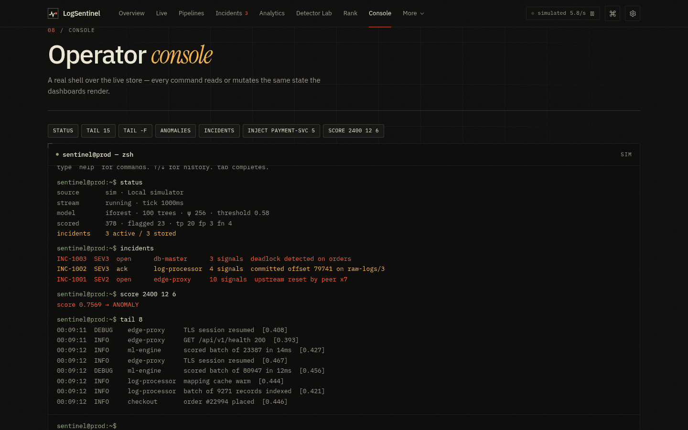 | 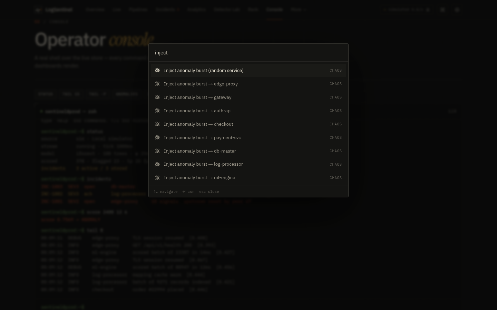 |

<details>
<summary>More pages — ROC tuning, how it works, security</summary>

| Threshold tuning (ROC / confusion matrix) | How it works |
| --- | --- |
| 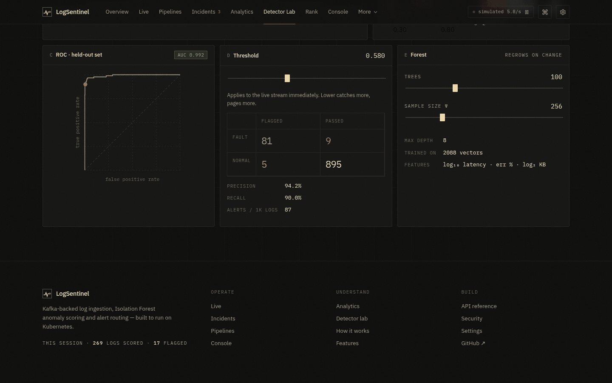 | 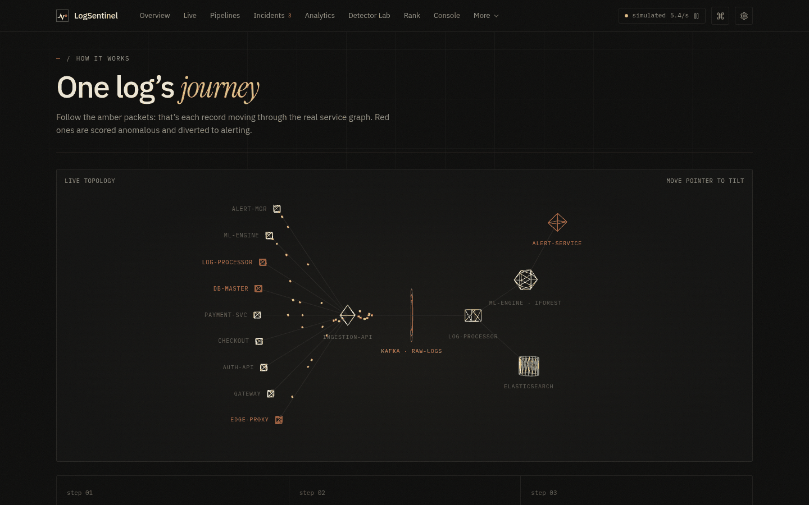 |
| **Security** | |
| 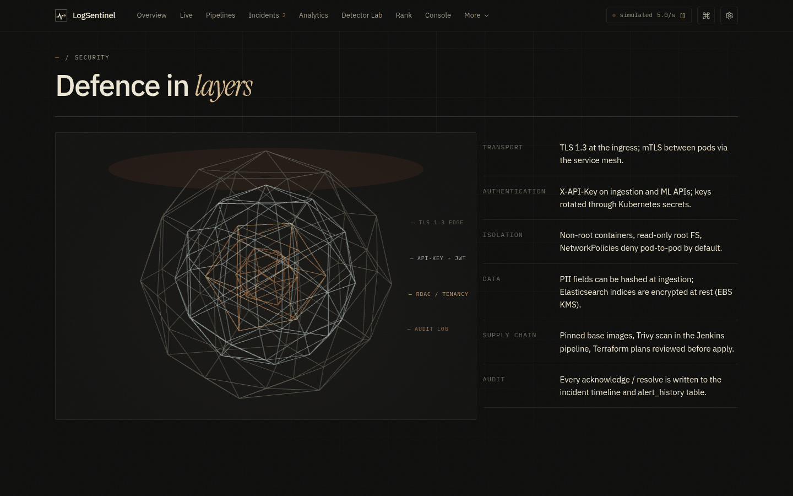 | |

</details>

## What it does

- **Collects** structured JSON logs from any service through one HTTP API (single record or batches of up to 100).
- **Streams** them through three Kafka topics so producers never wait on storage or the model.
- **Indexes** every processed record in Elasticsearch for search and dashboards.
- **Scores** each record with an Isolation Forest trained on six engineered features — no labelled incidents needed.
- **Alerts** on anomalies: deduplicated in Redis, persisted in PostgreSQL, sent to Slack and email.
- **Shows** it all on a live console with 3D views, plus Prometheus metrics and Grafana dashboards for every service.

## Architecture

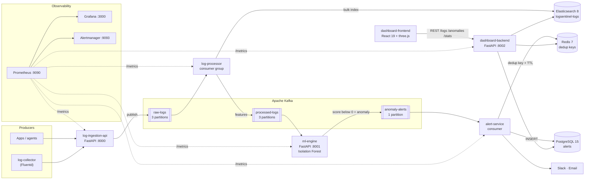

### Services

| Service | Port | Role |
| --- | --- | --- |
| `log-ingestion-api` | 8000 | FastAPI. Validates logs with Pydantic, stamps `log_id` + `ingested_at`, publishes to `raw-logs` |
| `log-processor` | — | Kafka consumer. Normalises fields, extracts ML features, bulk-indexes into Elasticsearch, republishes to `processed-logs` |
| `ml-engine` | 8001 | Consumes `processed-logs`, scores with Isolation Forest, publishes anomalies to `anomaly-alerts`. Also serves `/predict` |
| `alert-service` | — | Consumes `anomaly-alerts`, deduplicates in Redis (1 h TTL), stores in PostgreSQL, notifies Slack / email with retries |
| `dashboard-backend` | 8002 | Read API over Elasticsearch, PostgreSQL and a Redis cache for the frontend and Grafana |
| `dashboard-frontend` | 5173 (dev) | React + Vite operations console, deployed to Vercel |
| `log-collector` | — | Fluentd image that tails files / receives syslog and forwards to the ingestion API |

### Request flows

**Ingest → detect → alert**

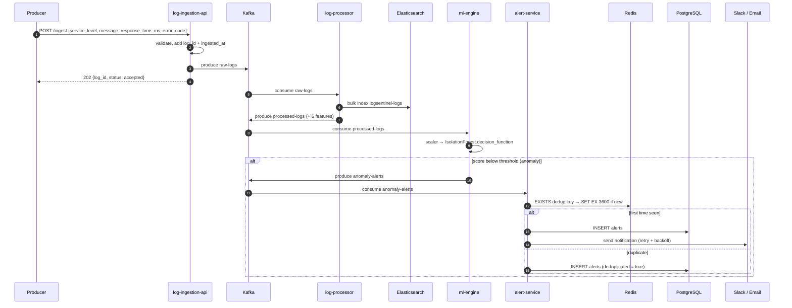

**Dashboard read path**

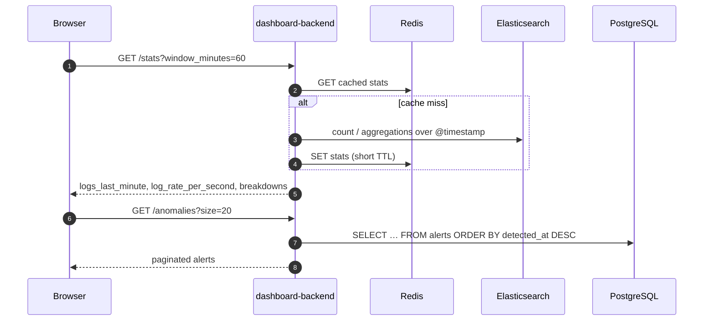

## Machine learning

The detector is scikit-learn's **Isolation Forest**. It builds random trees that split on a random feature at a random value. Unusual records get isolated in very few splits, so a **short average path length means an anomaly**. It needs no labelled incidents. It learns what normal looks like from the traffic itself.

| Parameter | Value |
| --- | --- |
| Estimators | 100 trees |
| Contamination | 0.05 (5 %) |
| Training set | 47,500 normal + 2,500 anomalous synthetic records |
| Pre-processing | `StandardScaler`, saved alongside the model |
| Decision | `decision_function < ML_ANOMALY_SCORE_THRESHOLD` (default `0.0`) |
| Artifacts | `ml/models/isolation_forest.joblib`, `scaler.joblib`, `training_metadata.json` |

| Feature | Type | Description |
| --- | --- | --- |
| `hour_of_day` | int | Hour of the event (0–23) |
| `response_time_ms` | float | Request / operation latency |
| `error_code` | int | HTTP or application error code |
| `log_level_encoded` | int | DEBUG 0 · INFO 1 · WARN 2 · ERROR 3 · CRITICAL 4 |
| `request_count_last_60s` | int | Rolling request count for the service |
| `service_id_encoded` | int | Encoded service identifier |

```bash
make train      # generate data, fit scaler + forest, write ml/models/*
make evaluate   # precision / recall / F1 on a held-out set
```

### The same model in the browser

`services/dashboard-frontend/src/lib/iforest.js` implements Isolation Forest from the original paper (Liu, Ting & Zhou, 2008), with a seeded PRNG so the forest is reproducible. The anomaly score is the usual one: `s(x) = 2^(−E[h(x)] / c(ψ))`. The frontend uses three features: log₁₀ latency, error rate and log₂ payload size. That is enough to draw the feature space in 3D. The **Detector Lab** shows the per-tree path lengths, a ROC curve with AUC on a held-out set, and a live confusion matrix as you move the threshold. With the defaults (100 trees, ψ = 256, threshold 0.58), normal traffic stays below about 0.54.

## Frontend

The console lives in `services/dashboard-frontend`. It is written in React 19 and Vite, uses three.js through `@react-three/fiber` / `drei` for 3D, and uses framer-motion for transitions. One live store (`src/lib/store.jsx`) feeds every page, so the dashboards, the console and the 3D scenes always show the same data.

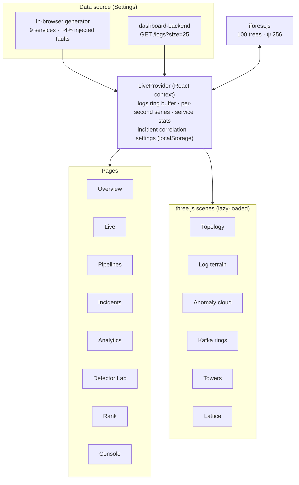

| Route | What you get |
| --- | --- |
| `/` | Landing page: live 3D pipeline topology, log ticker, stage meters, precision / recall against injected faults, feature-space cloud |
| `/live` | KPIs with sparklines, **3D log terrain** (service × time × volume), flagged feed, filterable stream (search, service, level, anomalies only), CSV / NDJSON export, per-log "why it scored this" breakdown, batch inference with a confusion matrix |
| `/pipelines` | **Kafka partition rings** (height = consumer lag), consumer groups, per-service stage latency breakdown |
| `/incidents` | Two or more anomalies on the same service inside the correlation window open an incident. You get acknowledge / resolve, timeline notes, MTTA / MTTR, auto-resolve and a copyable Markdown post-mortem |
| `/analytics` | Throughput vs anomalies, level mix, 3D feature space, 3-minute anomaly heatmap, anomaly rate by service, latency histogram |
| `/lab` | **Detector Lab**: shape a record with sliders or presets, see it in 3D, read the gauge and path-length histogram, tune the threshold on a ROC curve, regrow the forest, send the record into the live stream |
| `/rank` | Reliability leaderboard with **3D towers** |
| `/console` | Operator shell over the live store: `status`, `tail [-f]`, `anomalies`, `incidents`, `ack`, `resolve`, `inject`, `score <ms> <err%> <kb>`, `threshold`, `pause` / `resume`. Has history and tab completion |
| `/api-docs` | Every backend endpoint with curl samples, plus *try it* against your backend |
| `/settings` | Detection (threshold, trees, ψ, correlation window), stream rate, data source, desktop / sound notifications, 3D quality, reduced motion, workspace export / import / reset |
| `/workflow`, `/features`, `/security` | How it fits together, feature overview, layered security model |

Other details:
- **Ctrl / ⌘ + K** opens a command palette that can jump to any page, pause the stream, inject faults into any service or acknowledge an incident.
- New incidents raise a toast. Desktop notifications and a sound alert are opt-in.
- Each 3D scene is code-split and only mounts when scrolled into view. Without WebGL it shows a fallback instead.
- The design is deliberately restrained: warm carbon background, hairline panels, IBM Plex Sans / Mono with Instrument Serif accents, and one hot colour reserved for anomalies.

```bash
cd services/dashboard-frontend
npm ci
npm run dev        # http://localhost:5173
npm run build      # production bundle in dist/
```

## Data model

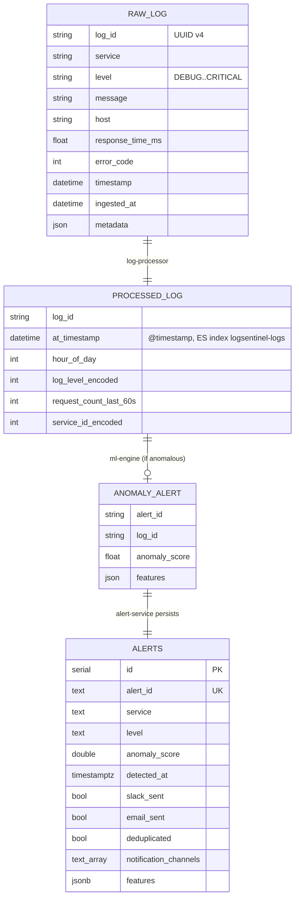

`ALERTS` is the PostgreSQL table defined in `infra/postgres/init.sql`, indexed on `detected_at`, `service`, `level` and `deduplicated`.

## Quick start

**Prerequisites:** Docker 24+ with Compose v2, Python 3.11+, Node.js 20+, Make.

```bash
git clone https://github.com/Arnazz10/logsentinel.git
cd logsentinel
cp env.example .env          # add SLACK_WEBHOOK_URL / SMTP_* if you want notifications
make up                      # Kafka, ES, Postgres, Redis, 5 services, Prometheus, Grafana
make health                  # checks every /health endpoint
make send-test-log           # or the curl below
```

```bash
curl -X POST http://localhost:8000/ingest \
  -H "Content-Type: application/json" \
  -d '{"service":"payment-svc","level":"ERROR","message":"stripe timeout after 4200ms","response_time_ms":4200,"error_code":504}'
```

Then start the console and connect it to the backend:

```bash
cd services/dashboard-frontend && npm ci && npm run dev
# open http://localhost:5173 → Settings → Data source → http://localhost:8002 → Apply
```

| Tool | URL | Credentials |
| --- | --- | --- |
| LogSentinel console | http://localhost:5173 | — |
| Ingestion API docs | http://localhost:8000/docs | — |
| ML engine API docs | http://localhost:8001/docs | — |
| Dashboard backend docs | http://localhost:8002/docs | — |
| Kafka UI | http://localhost:8090 | — |
| Grafana | http://localhost:3000 | admin / admin |
| Prometheus | http://localhost:9090 | — |
| Alertmanager | http://localhost:9093 | — |

### Configuration

All settings come from `.env` (see `env.example`). The ones you are most likely to change:

| Variable | Default | Purpose |
| --- | --- | --- |
| `KAFKA_BOOTSTRAP_SERVERS` | `kafka:9092` | Broker address for every service |
| `KAFKA_TOPIC_RAW_LOGS` / `_PROCESSED_LOGS` / `_ANOMALY_ALERTS` | `raw-logs` / `processed-logs` / `anomaly-alerts` | Topic names |
| `ELASTICSEARCH_INDEX_LOGS` | `logsentinel-logs` | Index written by the processor |
| `ML_N_ESTIMATORS`, `ML_CONTAMINATION` | `100`, `0.05` | Training hyper-parameters |
| `ML_ANOMALY_SCORE_THRESHOLD` | `0.0` | Decision-function cut-off for an anomaly |
| `ALERT_DEDUP_TTL_SECONDS` | `3600` | How long a repeated alert is suppressed |
| `ALERT_COOLDOWN_SECONDS`, `ALERT_MAX_RETRIES` | — | Notification throttling and retries |
| `SLACK_ENABLED`, `SLACK_WEBHOOK_URL` | — | Slack delivery |
| `SMTP_ENABLED`, `SMTP_HOST`, `SMTP_TO_EMAILS` … | — | Email delivery |
| `INGESTION_MAX_BATCH_SIZE`, `INGESTION_RATE_LIMIT_PER_MINUTE` | — | Ingestion guard rails |

## API

| Service | Method | Endpoint | Description |
| --- | --- | --- | --- |
| ingestion | `POST` | `/ingest` | Ingest one log entry |
| ingestion | `POST` | `/ingest/batch` | Ingest 1–100 entries |
| ingestion | `GET` | `/health` | Liveness + Kafka producer state |
| ml-engine | `POST` | `/predict` | Score one feature vector |
| ml-engine | `POST` | `/predict/batch` | Score many vectors |
| ml-engine | `GET` | `/model/status` | Loaded model metadata |
| dashboard | `GET` | `/logs` | Paginated search with `page`, `size`, `level`, `service`, `start`, `end`, `q` |
| dashboard | `GET` | `/anomalies` | Alerts from PostgreSQL |
| dashboard | `GET` | `/stats` | Log rate and breakdowns over `window_minutes` (Redis-cached) |
| dashboard | `GET` | `/health` | Elasticsearch, PostgreSQL and Redis checks |
| all | `GET` | `/metrics` | Prometheus metrics |

Ingest payload:

```json
{
  "service": "auth-service",
  "level": "ERROR",
  "message": "Database connection timeout after 5000ms",
  "response_time_ms": 5000,
  "error_code": 500,
  "host": "pod-abc123",
  "metadata": { "region": "ap-south-1" }
}
```

Prediction payload:

```json
{
  "hour_of_day": 3,
  "response_time_ms": 4500.0,
  "error_code": 503,
  "log_level_encoded": 3,
  "request_count_last_60s": 1200,
  "service_id_encoded": 2
}
```

## Observability

Every FastAPI service exposes `/metrics`. The most useful series are `http_requests_total`, `http_request_duration_seconds`, `logs_ingested_total`, `anomalies_detected_total` and `kafka_publish_errors_total`. Prometheus also scrapes `node-exporter` (:9100) and `kafka-exporter` (:9308). Alert rules live in `monitoring/prometheus/alert-rules.yml` and are routed by Alertmanager. Grafana loads its dashboards from `monitoring/grafana/` at startup.

## Infrastructure and delivery

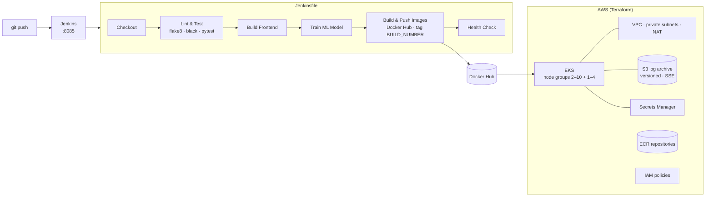

- **Terraform** (`infra/terraform`) creates the VPC and EKS modules, an encrypted and versioned S3 bucket, Secrets Manager, IAM policies for S3 and secret access, and ECR repositories with lifecycle rules.
- **Kubernetes** (`infra/kubernetes`) holds a namespace, deployments for all five services, services, config maps, secrets, HPAs and an ingress. A Helm chart at `infra/helm/logsentinel` packages the same thing.
- **Jenkins** (`docker compose -f docker-compose.jenkins.yml up -d`, UI on :8085) needs the credentials `docker-hub-creds`, `kube-config-id`, `aws-creds` and `logsentinel-secrets`.
- **Vercel** hosts only the frontend. Its config is in `services/dashboard-frontend/vercel.json`, and the Vercel project's root directory must be `services/dashboard-frontend`.

```bash
make terraform-init && make terraform-plan && make terraform-apply
make deploy                   # kubectl apply -f infra/kubernetes
make helm-install             # or the Helm chart
```

## Tech stack

| Layer | Technology |
| --- | --- |
| Services | Python 3.11, FastAPI, Pydantic, aiokafka, elasticsearch-py, asyncpg, redis-py |
| Streaming | Apache Kafka (Confluent 7.5) + Zookeeper, Kafka UI |
| Storage | Elasticsearch 8.11, PostgreSQL 15, Redis 7 |
| ML | scikit-learn Isolation Forest, StandardScaler, joblib, pandas / NumPy |
| Frontend | React 19, Vite 8, React Router 7, three.js + @react-three/fiber + drei, framer-motion, lucide-react |
| Observability | Prometheus, Grafana 10, Alertmanager, node-exporter, kafka-exporter |
| Infrastructure | Docker, Kubernetes (EKS), Helm, Terraform (AWS), Jenkins, Vercel |
| Testing | pytest (unit + integration), Locust (load) |

## Project structure

```text
logsentinel/
├── services/
│   ├── log-collector/         Fluentd image that forwards to the ingestion API
│   ├── log-ingestion-api/     FastAPI → Kafka raw-logs
│   ├── log-processor/         raw-logs → Elasticsearch + processed-logs
│   ├── ml-engine/             processed-logs → Isolation Forest → anomaly-alerts
│   ├── alert-service/         anomaly-alerts → Redis dedup → Postgres → Slack / email
│   ├── dashboard-backend/     Read API for the console and Grafana
│   └── dashboard-frontend/
│       ├── src/lib/           engine.js (generator) · iforest.js · store.jsx (live state)
│       ├── src/three/         Topology · Terrain · AnomalyCloud · KafkaRing · Towers · Lattice
│       ├── src/pages/         Home · Dashboard · Incidents · Lab · Analytics · Pipelines · Rank · Console · …
│       ├── src/components/    Navbar · CommandPalette · Toasts · ui kit
│       └── vercel.json
├── ml/                        train.py · evaluate.py · predict.py · models/
├── pipeline/                  kafka/ and fluentd/ configs
├── infra/                     terraform/ · kubernetes/ · helm/ · jenkins/ · postgres/init.sql
├── monitoring/                prometheus/ (rules, alertmanager) · grafana/ (dashboards, provisioning)
├── tests/                     unit/ · integration/ · load/locustfile.py
├── docs/                      ARCHITECTURE.md · PRD.md · DEMO_GUIDE.md · screenshots/
├── docker-compose.yml         Full local stack
├── docker-compose.jenkins.yml Jenkins server
├── Jenkinsfile
└── Makefile
```

## Make targets

```bash
make up / down / ps / logs        # local stack
make build / push                 # images
make test / test-unit / test-integration / test-load
make lint / format
make train / evaluate / notebook  # ML
make send-test-log / send-bulk-logs
make deploy / deploy-prod / helm-install / helm-upgrade
make terraform-init / terraform-plan / terraform-apply / terraform-destroy
make clean / clean-all
make help                         # everything, with descriptions
```

## Security

| Layer | Mechanism |
| --- | --- |
| Secrets | AWS Secrets Manager and Kubernetes Secrets. Nothing is baked into images |
| Network | Private subnets behind NAT, security groups, Kubernetes ingress as the only entry point |
| Storage | S3 server-side encryption with versioning and public access blocked |
| Identity | IAM policies scoped to the S3 bucket and secrets |
| Containers | Non-root users, slim multi-stage images |
| Frontend | Fully static on Vercel. Backend URL and settings stay in the viewer's browser |

## Notes

- The hosted demo is simulated on purpose so it works without a backend. The precision and recall it shows are measured against faults the generator injected, so they are real numbers for that synthetic traffic.
- `env.example` holds development defaults only. Change every password before deploying.
- No licence file is included yet. Add one before accepting outside contributions.

---

Built by **[Arnab Mal](https://github.com/Arnazz10)**.
